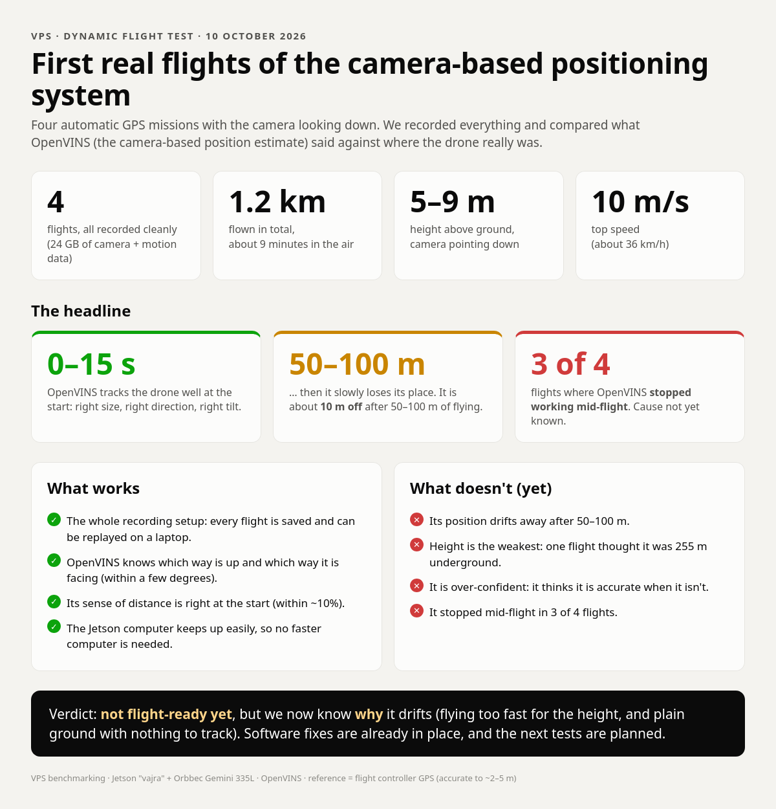
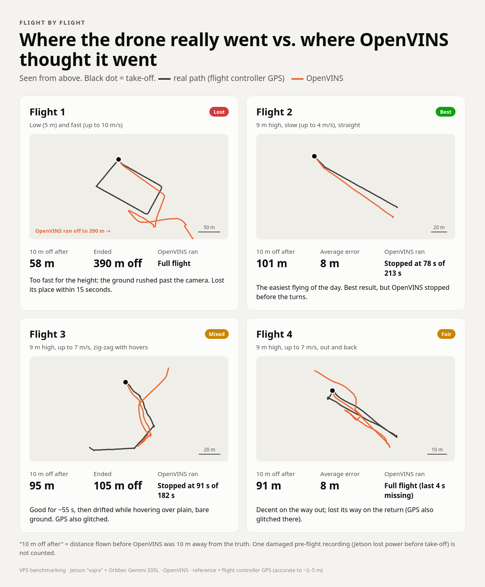
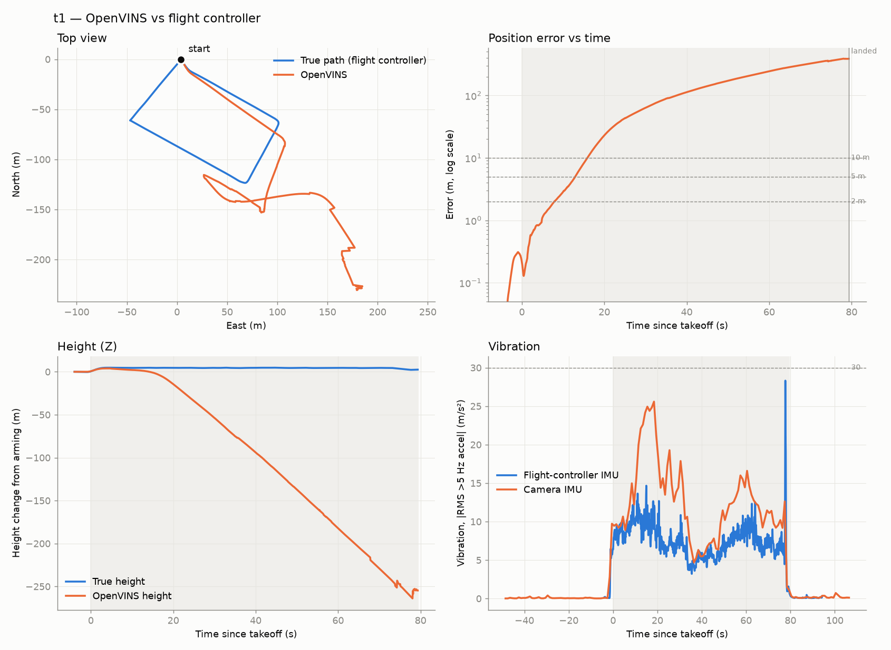
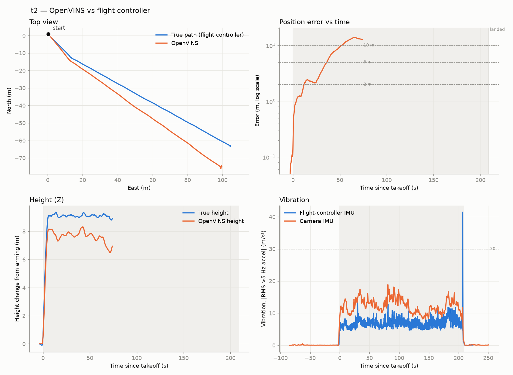
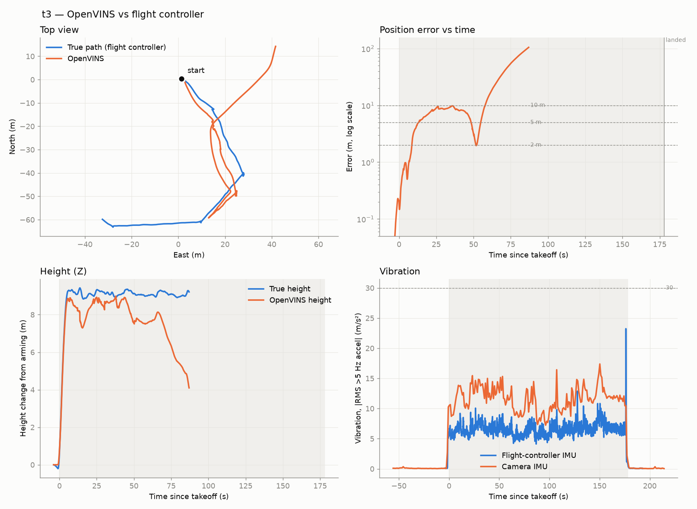
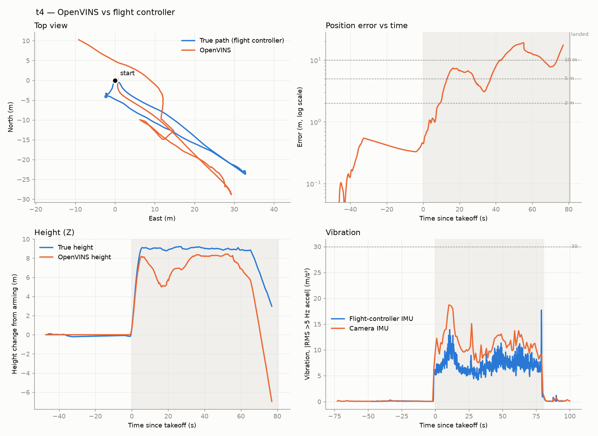
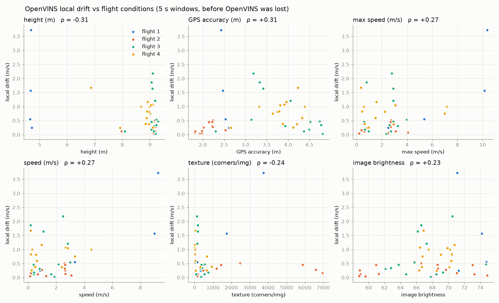
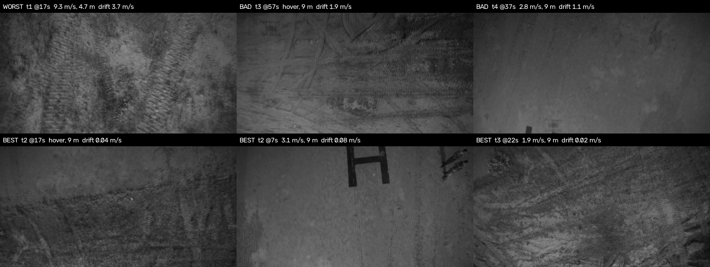
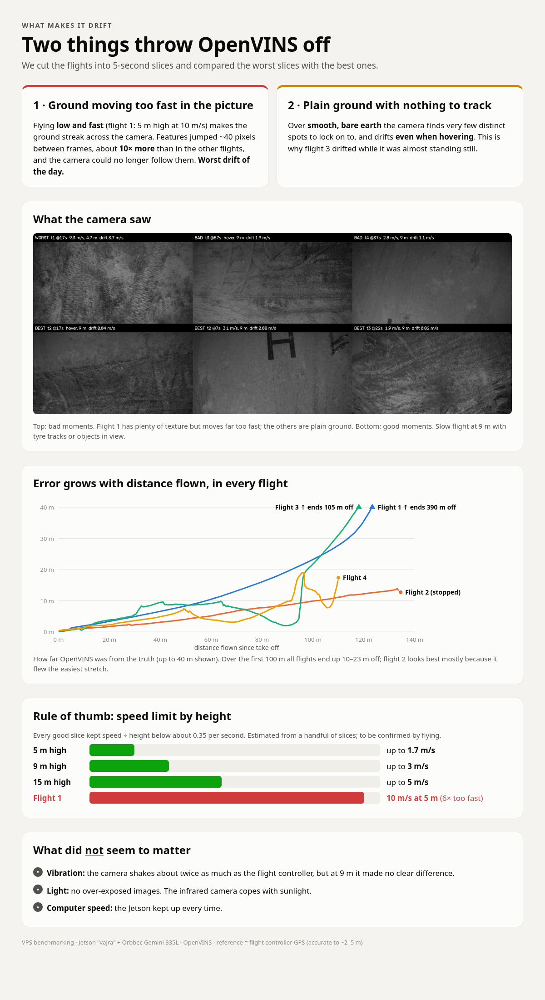

# Flight analysis: first dynamic flight tests, 10 Oct 2026

Detailed analysis of four flights comparing the OpenVINS estimate (stereo IR + Orbbec built-in IMU,
running live on the Jetson) against the flight controller's telemetry. Scripts:
[`scripts/analysis/`](../../../scripts/analysis/). Conclusions and next steps in short:
[`docs/HANDOFF_2026-10-10.md`](../../HANDOFF_2026-10-10.md). Plain-language summary images:
[`infographic/`](infographic/).

---

## 1. Setup

| | |
|---|---|
| Airframe / FC | Quad (H frame), CubeOrange+, ArduCopter 4.6.3, all flights automatic GPS missions (AUTO mode, RTL at end) |
| VPS | Jetson Orin Nano (`vajra`, MAXN_SUPER), Orbbec Gemini 335L: stereo IR 848×480 @ 30 fps (projector off), built-in IMU @ 493 Hz |
| Estimator | OpenVINS (ov_msckf, v2.7-20 + local patches), `config/` as committed; `track_frequency: 21` → processes ~15 Hz |
| Camera mounting | **facing down**, tilted 6–8° from vertical (measured from the gyros, see §2) |
| Recorded | raw stereo IR + camera_info + IMU + OpenVINS outputs (`record_bag.sh`); FC DataFlash `.bin` logs |
| Reference | FC EKF3 position (`XKF1`, GPS + IMU + baro). GPS horizontal accuracy 1.8–4.9 m, vertical 3.1–9.8 m (`GPA`) |

Bag ↔ log pairing is in [`PAIRING.txt`](PAIRING.txt). Flight 4's bag was recorded with the Jetson clock
at 1970; the correction is in [`test4_clock_offset.txt`](test4_clock_offset.txt) and was confirmed by
gyro sync to 0.025 s. A fifth bag (`stage3_flight1_1037`) is damaged (Jetson lost power before
take-off) and not a flight. Bags and `.bin` logs are **not** in the repo (size, and the logs contain the
site's GPS coordinates); all results here are in local metres.

## 2. Method

1. **Time alignment.** |gyro| of the camera IMU and the FC IMU, both low-passed at 1.5 Hz, are
   cross-correlated (rotation-invariant). Correlation 0.993–0.996 in all flights; bag clock offsets
   −0.53, −1.24, −1.58, +0.03 s.
2. **Mounting.** Kabsch fit of the two gyro vector streams gives camera-IMU → FC-body rotation
   (camera z-axis 6.1–8.0° from body-down, consistent across flights).
3. **Frame link.** VIO-world → ENU heading = FC attitude × mounting × VIO attitude, averaged before
   take-off. No trajectory fitting: the VIO estimate is **anchored at arming** (as it would be used live).
   A best-fit 4-DoF alignment (yaw + translation over the whole flight) is reported for comparison only.
4. **Metrics** on the part of each flight OpenVINS actually covered: ATE, true drift
   (end error ÷ **reference** path length), scale, per-axis error, distance/time until the error exceeds
   2/5/10 m, vibration, heading drift, output rate, and filter consistency (share of time the true error
   is inside OpenVINS's own 3σ).
5. **Conditions** (§5): every flight is cut into 5 s windows. For each window, the *local* drift
   (error added in that window, after removing heading error accumulated earlier) is compared with
   speed, height, turn rate, vibration and image measures from the camera frames.

> The old `compute_drift.py` divides by OpenVINS's *own* path length, which inflates when it diverges.
> Flight 1: 58–61 % with that method vs a true **95 %**. Use `analyze_flight.py`.

## 3. Results per flight

| | Flight 1 | Flight 2 | Flight 3 | Flight 4 |
|---|---|---|---|---|
| Profile | **4.6 m, ≤10.4 m/s**, rectangle | 9.1 m, ≤4.1 m/s while OV ran, straight | 9.1 m, ≤7 m/s, zig-zag + hovers | 8.9 m, ≤7.1 m/s, out and back |
| True path flown (while OV ran) | 406 m (406) | 428 m (**135**) | 280 m (**141**) | 114 m (112) |
| OpenVINS coverage | full | **stopped at 78 s** of 213 | **stopped at 91 s** of 182 | stopped 4 s before disarm (on descent) |
| ATE anchored, RMSE / max | 182 / 389 m | **7.8 / 13.9 m** | 32.6 / 105 m | **7.6 / 19.0 m** |
| ATE best-fit 4-DoF, RMSE | 126 m | 1.5 m | 29.2 m | 6.7 m |
| End error ÷ true path | 387 m / 406 m = **95 %** | 12.7 / 135 m = 9.4 %¹ | 105 / 141 m = 75 %¹ | 17.4 / 112 m = **15.5 %** |
| Scale: early (sim3 / path) · whole | 0.90 / 1.06 · 1.56 | 0.97 / 1.02 · 1.03 | 0.85 / 1.09 · 1.27 | 0.98 / 1.00 · 1.19 |
| Per-axis RMSE E / N / Up | 84 / 89 / **135** m | 2.8 / 7.1 / 1.4 m | 22.6 / 23.5 / 1.7 m | 5.9 / 4.0 / 2.5 m |
| Error > 5 m after | 13 s / 30 m | 36 s / 59 m | 13 s / 29 m² | 13 s / 40 m |
| Error > 10 m after | **16 s / 58 m** | 52 s / 101 m | 58 s / 95 m | 42 s / 91 m |
| Heading drift max · tilt agreement max | 11.1° · 4.4° | 7.2° · 2.4° | 15.4° · 3.4° | 9.2° · 3.4° |
| Error inside own 3σ | 5 % | 5 % | 10 % | 8 % |
| Vibration mean Z: FC / camera IMU (m/s²) | 6.6 / 10.1 | 6.0 / 10.2 | 5.7 / 9.7 | 5.9 / 9.5 |
| GPS during flight | OK | OK | **"GPS Glitch"** 17–39 s, 46–53 s | **"GPS Glitch"** on the return |

¹ Measured at the last OpenVINS output, not a closed loop. ² Likely inflated by the GPS glitch.
Full per-flight output: `tN_metrics.txt` / `.json`; figures `tN_report.png`.

### Flight 1: fast and low (lost)

Tracks the first leg (scale 0.90–1.06 for 13 s), then diverges at the first corner: velocity bias,
height sinking linearly to −255 m, still "moving" 8–13 m/s after landing. Attitude stays good
(tilt ≤ 4.4°), so the loss is in position/velocity, i.e. the visual updates stopped constraining the
filter. Camera vibration peaked (~25 m/s²) at 10–20 s, the same time the drift started.

### Flight 2: slow, straight, best (stopped at 78 s)

Shape almost exact (best-fit RMSE 1.5 m, within GPS accuracy); the anchored error is mostly a **~6°
heading rotation** (6° over 100 m ≈ 10 m sideways). Height ~1–2 m low but stable.

### Flight 3: zig-zag with hovers (stopped at 91 s)

≤ ~10 m for 55 s (partly GPS glitch), then from ~71 s the VIO speed rises 2 → 5.6 m/s **while the drone
hovers at 0.2 m/s**, and its own σ grows 1.2 → 8 m (visual updates weakening). Lowest vibration of all
flights, so neither speed nor vibration explains it; the ground had the least texture of the day (§5).

### Flight 4: out and back (near-complete)

Outbound leg 3–7 m error (5–8° heading offset). Height dips 4 m at +15 s (vibration peak 18.7 m/s²),
descends ~10 s before the real descent and overshoots to −7 m. Diverges NW on the return, the same
time as a "GPS Glitch", so part of that error is the reference.

## 4. Same-distance comparison

| Error after flying | 25 m | 50 m | 75 m | 100 m | First 100 m: mean / max speed · height · turn rate |
|---|---|---|---|---|---|
| Flight 1 | 4.2 | 8.3 | 14.6 | **23.2** | 5.0 / 10.4 m/s · 4.7 m · 2.4°/s |
| Flight 2 | 2.1 | 4.0 | 7.3 | **9.9** | 1.8 / 4.1 m/s · 9.1 m · 1.0°/s |
| Flight 3 | 4.4 | 8.6 | 6.7 | **21.7** | 1.4 / 4.0 m/s · 9.1 m · 1.8°/s |
| Flight 4 | 3.0 | 6.9 | 4.3 | **13.4** | 1.6 / 7.1 m/s · 9.0 m · 2.4°/s |

Over the first 100 m all flights end up 10–23 m off. **Flight 2 looks best mainly because OpenVINS
stopped after its easiest stretch** (one straight leg, least turning); at equal distance it is only
moderately better. Single flights and a 2–3 m GPS reference: differences of a few metres are not significant.

## 5. What drives the drift (5 s windows)

60 windows; **45 "healthy"** (accumulated error < 20 m; what *starts* drift) and 15 after OpenVINS
was already lost. Full numbers: [`conditions_report.txt`](conditions_report.txt).

Median local drift in healthy windows: flight 1 1.06 m/s, flight 2 0.21, flight 3 0.46, flight 4 0.82.

| Condition (healthy windows) | Median local drift by bin |
|---|---|
| Height | < 6 m: **1.06** m/s (n=4) · 6–12 m: 0.44 (n=41) |
| Texture (FAST corners / image) | < 300: **0.82** (n=22) · 300–600: 0.31 (n=11) · 600–900: 0.26 (n=3) |
| Image sharpness (Laplacian var.) | < 80: **0.82** (n=21) · 80–120: 0.32 (n=16) |
| Speed | 0–0.5: 0.26 · 0.5–2: 0.28 · 2–4: 0.47 m/s (few windows faster) |
| Camera vibration | 8–12: 0.34 · 12–16: 0.46 · 16–40: 1.57 (n=3, all flight 1, confounded with speed and height) |

Rank correlations are weak (|ρ| ≤ 0.31); nominally significant only **height** (ρ = −0.31) and
**GPS accuracy** (+0.31: part of the measured "drift" is reference error, which flatters flight 2,
the flight with the best GPS).

**Maximum drift: image motion too large.** Flight 1's worst window (9.3 m/s at 4.7 m) had features
moving **~45 px between consecutive frames** (~10× the other flights), and the only drop in tracking
success of the day (track ratio 0.79). The ground there was richly textured (≈3750 corners), so the
cause is motion, not scene. With `track_frequency: 21`, OpenVINS sees every other frame, i.e. ~2× that motion.

**Second: low-texture / low-contrast ground**, which causes drift even when slow or hovering
(flight 3 at 57 s: 0.2 m/s, 178 corners, drift 1.9 m/s; flight 4 at 37 s: almost uniform bare ground,
5 corners). The best windows had slow flight at 9 m with tyre tracks or objects in view.

**Not supported:** vibration at 9 m (ρ = +0.10), acceleration, climb rate, brightness (no saturated
pixels in any frame), compute (OpenVINS output latency stayed 40–75 ms to the end).

**Provisional speed rule:** all good windows had speed ÷ height ≤ ~0.35 s⁻¹ (≈ ≤ 1.7 m/s at 5 m,
≤ 3 m/s at 9 m, ≤ 5 m/s at 15 m). Flight 1 flew at ≈ 2 s⁻¹. Based on few windows; to be confirmed.

## 6. OpenVINS stopping mid-flight (flights 2, 3, 4)

- All OpenVINS outputs stop **at the same instant**; the camera and recorder continue.
- Output latency was normal (≈ 40–75 ms) right up to the last message, with no backlog, so not overload.
- Flight 2 stopped hovering 122 m out, and flight 3 69 m out (both their farthest point so far);
  flight 4 stopped 0.5 m from home at 2.9 m height during descent.
- No exit in the launch logs of flight 2's run (the Jetson's system journal from those boots is gone).
  Other runs in the logs show **spontaneous segfaults** (exit −11), but every boot logged in "1970",
  so they cannot be matched to flights.
- Hypotheses: (a) OpenVINS blocked writing its console output to an SSH terminal whose Wi-Fi link
  dropped; (b) a genuine crash. Flight 4 argues against (a) alone.
- Since then: per-flight log files, processes detached from SSH (`flight_*` scripts), crash dumps
  enabled, and the clock fixed, so the next occurrence will be diagnosable.

## 7. Caveats

- Four flights with four different profiles; there are no repeats, and several variables change together.
- Reference accuracy 2–5 m (worse in glitches): good enough to see tens of metres, too coarse for
  ~1–3 % drift. RTK needed for that.
- Heading is aligned once before take-off from the FC's EKF heading (which itself uses GPS); in
  GPS-denied use the reference heading would come from the compass alone.
- The speed ÷ height rule and the texture effect are inferred from 45 windows and should be confirmed
  with controlled flights (handoff, "Next flight day checklist").
