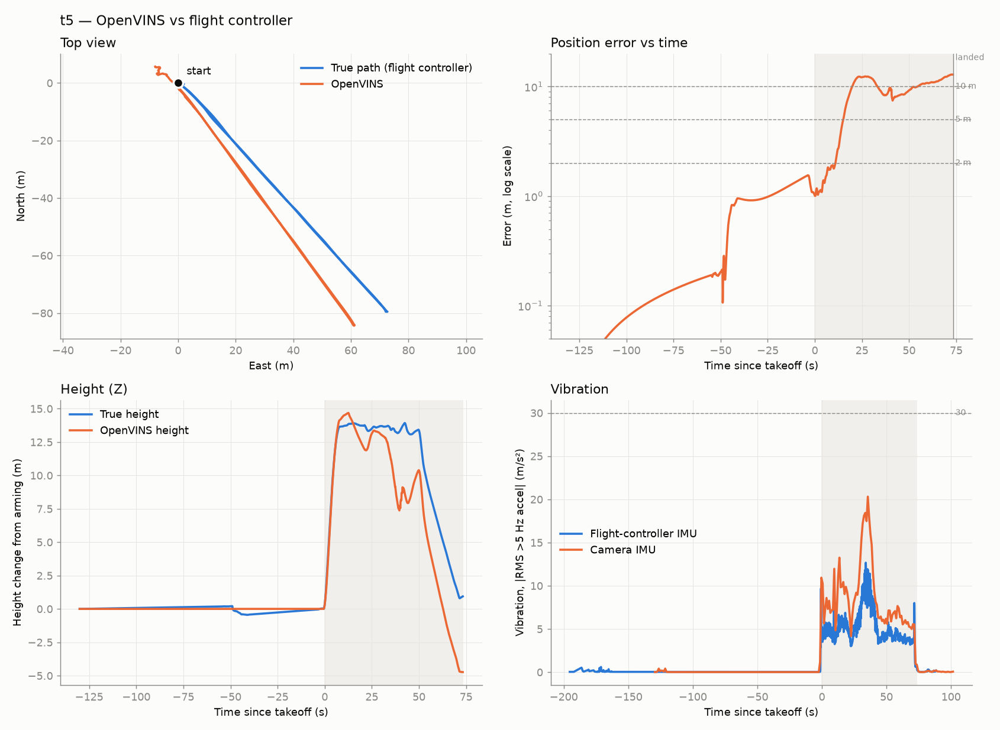
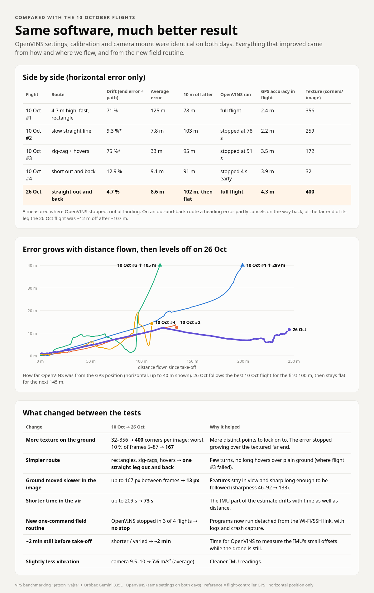
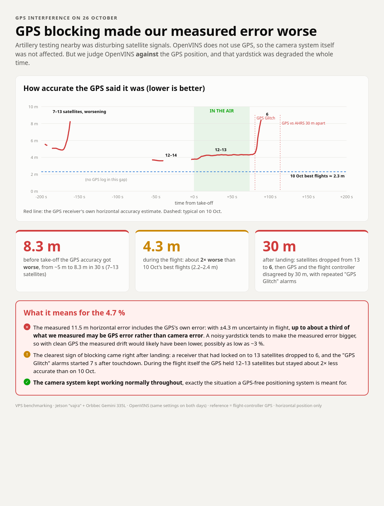
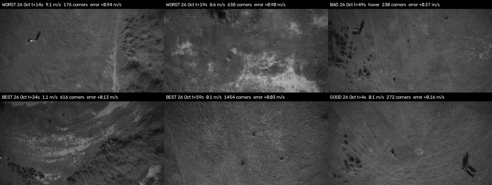
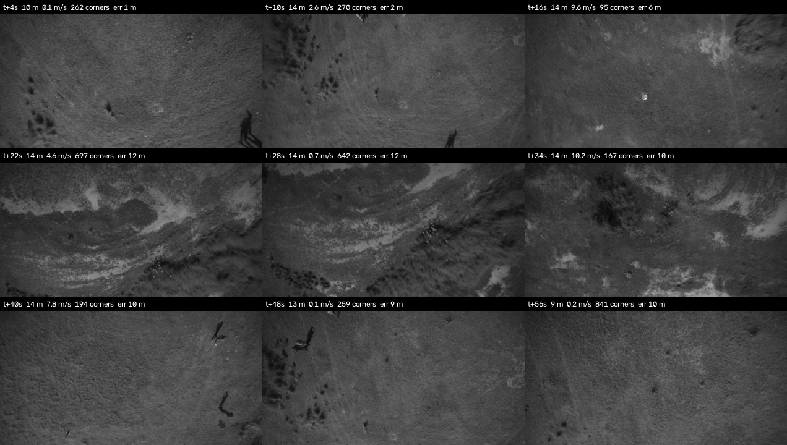

# Flight analysis: 26 Oct 2026 (flight05), compared with 10 Oct

Second flight-test day. One valid flight (`flight05`) analysed against the flight-controller log
with [`scripts/analysis/`](../../../scripts/analysis/), and compared with the four 10 Oct flights
([`../2026-10-10/`](../2026-10-10/)). Plain-language summary: [`infographic/`](infographic/).

**Height (Z) is not evaluated here** (a lidar reference is planned); headline numbers are horizontal.

---

## 1. Session overview (26 Oct, vajra)

| Session | What | Result |
|---|---|---|
| `flight01_090842` | bench, OpenVINS up | used to diagnose the `flight_status` false alarm (§6) |
| `flight02_092354` | bench static test, 44 s recorded | ✅ OpenVINS drift **0.3 cm** over 44 s, height 0.0 cm; clean shutdown **under load** (first test of the SIGINT fix while processing images) |
| `flight03_105051`, `flight04_105730` | initialised, 31 s recorded on the ground | ✅ clean; no flight (camera never moved: no motor vibration) |
| **`flight05_110100`** | **real flight** (recorded 11:02:47–11:06:40, airborne ≈ 11:04:56–11:06:08) | ✅ analysed below |
| `flight06_112152` | recording 11:24:43 → **Jetson lost power at ~11:27:35** | ❌ `metadata.yaml` 0 bytes, db3 malformed (4.8 GB); logs end in NUL bytes. Second power loss of the day |
| `flight07_112938` | OpenVINS up and stopped cleanly | no recording (`flight_record` not run) |

Flight05 bag: `~/Desktop/flight_tests_2026-10-26/flight05_110100` on the ground PC (copy verified by
sha256 against vajra). FC log: `log_29_2026-10-26-11-10-42.bin` (not in the repo: it contains GPS coordinates).

## 2. What was flown (from the `.bin` log)

ArduCopter 4.6.3, AUTO mission: `Takeoff` (t−2.2 s) → `WP` (t+7.4 s, reached t+25.2 s) → `ChangeSpeed`
→ `RTL`. Straight leg **~107 m** out and back along the same track (return within 0.7 m of the
outbound track), landed **0.8 m** from the take-off point. Airborne 73 s, path 245 m (horizontal),
**max 10.2 m/s**, ~13.5–14 m height. `WPNAV_SPEED = 1000` (10 m/s), `WP_YAW_BEHAVIOR = 2`.

**Yaw:** the nose turned **~35° at up to 47°/s between t+6 and t+14 s** to face the waypoint
(FC heading, FC gyro and camera gyro agree). **No yaw at the turnaround**: RTL flew back with the
heading unchanged (−33°, < 5°/s).

## 3. Results (`t5_metrics.txt`, `t5_report.png`)

| Metric | Flight05 |
|---|---|
| Time sync (camera vs FC gyro) | correlation 0.985, bag = GPS time −0.435 s |
| Camera mounting (gyro fit) | facing down, 8.1° from body-down (6.1–8.0° on 10 Oct: unchanged mount) |
| OpenVINS coverage | **whole flight**, 15.0 Hz, no gaps > 0.17 s, clean shutdown, no core dump |
| **Horizontal end error** | **11.5 m over 245 m = 4.7 %** (out-and-back, see caveat) |
| Horizontal error at the far end | ~12 m after ~107 m (≈ 11 % one-way) |
| Horizontal ATE (anchored) RMSE / max | **8.6 / 12.4 m** |
| Horizontal error > 5 m / > 10 m after | 54 m / **102 m**, then flat (10.0 m at 150 m, 8.5 m at 200 m) |
| Scale (whole flight / early sim3) | **1.00** / 0.99 |
| Heading error vs FC | −3.5° (t+10) → **+3.7° (t+18)** → steady **+5–6°** to landing |
| Error inside OpenVINS's own 3σ | **41 %** (10 Oct: 5–10 %) |
| Vibration mean Z: FC / camera IMU | 4.2 / 7.6 m/s² (10 Oct: ~6 / 9.5–10); camera peak 18.5–20 m/s² at t+35–38 s |
| 3D (for the record) | ATE RMSE 5.6 m; Z at landing −5.7 m; Z dipped ~6 m at t+35–40 s (coincides with the camera vibration peak) |

**Error profile:** horizontal error grew 2 → 12 m during t+10–22 s (the fast outbound leg, ~9 m/s,
with the 35° yaw at t+6–14 s), stayed ~12 m at the waypoint, **decreased** to ~8–9 m on the return
(heading error cancels on a retraced line), then rose to 11.5 m at landing. The ~6° heading offset
(×107 m ≈ 11 m) explains most of the horizontal error. The heading jump coincides with the fast yaw
turn **and** the hard acceleration; they cannot be separated in this flight.

**Caveat:** an out-and-back route flatters the end-point drift. Compare one-way (~11 %) or the
error-vs-distance curve with routes that don't retrace.

## 4. Comparison with 10 Oct (horizontal)

| Flight | Route | End drift | Avg error | > 10 m after | OpenVINS ran | GPS HAcc in flight (median) | Corners/img (median, air) |
|---|---|---|---|---|---|---|---|
| 10 Oct #1 | 4.7 m high, ≤10.4 m/s, rectangle | 71 % | 125 m | 78 m | full | 2.4 m | 356 |
| 10 Oct #2 | slow straight line | 9.3 %¹ | 7.8 m | 103 m | stopped at 78 s | 2.2 m | 259 |
| 10 Oct #3 | zig-zag + hovers | 75 %¹ | 33 m | 95 m | stopped at 91 s | 3.5 m | 172 |
| 10 Oct #4 | short out and back | 12.9 % | 9.1 m | 91 m | stopped 4 s early | 3.9 m | 32 |
| **26 Oct #5** | **straight out and back, ≤10.2 m/s, ~14 m** | **4.7 %** | **8.6 m** | **102 m, then flat** | **full** | **4.3 m** | **400** |

¹ at the point OpenVINS stopped. 3D error after 25/50/75/100/150/200 m flown — 26 Oct: 2.6 / 4.7 / 7.4 / 10.0 / 10.0 / 8.5 m;
best 10 Oct (#2): 2.1 / 4.0 / 7.3 / 9.9 / – / – m; 10 Oct #1: 4.2 / 8.3 / 14.6 / 23.2 / 53.5 / 89.4 m.

### What changed between the iterations

**No estimator change**: same OpenVINS build (`577805b` patches), same `config/` (md5 fingerprints in
`session.txt`), same calibration and mount. Changes:

| Change | 10 Oct → 26 Oct | Effect |
|---|---|---|
| Ground texture | median 32–356 → **400** FAST corners/img; worst 10 % 5–87 → **167**; sharpness 46–92 → **133** | error stopped growing over the textured far end |
| Image motion | max 17–167 → **13 px/frame** (height ~14 m; speed ÷ height peaked ~0.72 s⁻¹, above the provisional 0.35 limit, yet stable) | the 0.35 s⁻¹ rule looks conservative at this height |
| Route | rectangles / zig-zags / hovers → **one straight out-and-back** | few turns, no long hovers, heading error partly cancels |
| Air time | up to 209 s → **73 s** | less IMU drift |
| Field routine | 3 SSH terminals → **`flight_*` scripts, processes detached from SSH** | **no mid-flight stop** (10 Oct: 3 of 4). Consistent with the SSH-output-blocking hypothesis (KNOWN_ISSUES #7); one flight does not prove it |
| Still period before take-off | ~50–85 s → **~2 min** (ZUPT active) | more time to estimate IMU bias (gyro bias directly observable at rest) |
| Vibration | camera ~9.5–10 → **7.6 m/s²** mean | slightly cleaner IMU |
| GPS reference | HAcc 2.2–3.9 → **4.3 m** in flight | reference **worse** (§5) |

## 5. GPS interference (reference quality)

GPS was disturbed by artillery testing nearby. OpenVINS does not use GPS; the **reference** (FC EKF
fused with GPS) was degraded:

| Period (relative to take-off) | Satellites | HAcc | Notes |
|---|---|---|---|
| −195 … −174 s (just after FC power-on) | 7–13 | 4.9 → **8.3 m** (worsening, not converging) | |
| −100 … −60 s | — | — | gap in the GPS log |
| −55 … 0 s | 12–14 | 3.6–3.8 m | |
| **0 … 73 s (airborne)** | 12–13 | **3.8–4.4 m** | ~2× worse than the best 10 Oct flights (2.2–2.4 m); EKF vs raw GPS within 0.1–2.2 m |
| +73 … +88 s | 13 → **6** | **8.5 m** | `GPS Glitch or Compass error` at **+80 s**, `EKF variance` +98 s, `GPS and AHRS differ by 30.2m` +113 s, repeated `GPS glitching` until +346 s |

No glitch occurred while airborne. With ±4.3 m reference uncertainty, up to ~a third of the 11.5 m
measured end error may be reference error; zero-mean reference noise inflates measured error on
average (E|a + b| ≥ |a|), so the true drift was likely **lower than 4.7 %** (≈ 3 % if the full 4.3 m
were reference error). Not quantifiable further without a better reference (RTK).

## 6. Field-routine findings (26 Oct)

- **`flight_status` false "NO OUTPUT NOW (stalled?)"** while OpenVINS published 15 Hz. Three causes, found
  in sequence: (1) 3 s timeout too short for `ros2 topic hz` startup on the Jetson (fixed `822e49f`);
  (2) **ROS daemon started from shells with different `ROS_LOCALHOST_ONLY`** (0 vs 1) cannot see the
  localhost-only processes; (3) **`timeout` backgrounds the ROS CLI; in an interactive TTY it is
  stopped (SIGTTOU/SIGTTIN)**, so it never answers. Only reproducible with a TTY (`ssh -tt`).
  Final fix: `ov_live` (OpenVINS initialised **and** `openvins.log` written within 3 s); daemon-free
  `topic_alive` (`ros2 topic echo --once --no-daemon`); `timeout --foreground … </dev/null`;
  `flight_start` restarts the ROS daemon; `export ROS_LOCALHOST_ONLY=1` in vajra's `~/.bashrc`.
  **These later fixes are on vajra, not yet committed** (Jetson was offline when this was written).
- **Jetson power losses:** before 11:20 and at ~11:27:35 (lost `flight06`). Then the Jetson was
  switched off ~11:47 → ~19:34 (normal). Clock restore worked after each boot (restored to last stamp;
  synced from the PC before recording).
- **OpenVINS cost:** `[TIME]` ~6 ms per frame (~160 Hz capacity) on MAXN_SUPER → processing all 30 fps
  (`track_frequency` → 31) is affordable CPU-wise.
- **Initialisation:** hold still 2–3 s, then a smooth 30–50 cm slide; confirm with `flight_status` before take-off.

## 7. Camera frames

Labelled with time after take-off, speed, FAST corners and horizontal error growth rate.

Worst windows are the **fast** ones (t+12–22 s, ~0.9 m/s error growth), over uniform grass
(176 corners) **and** over varied ground (638 corners). Part of that growth is the heading offset,
which adds more sideways error per second at higher speed. Best: slow passes over the textured channel
(616 corners) and the descent (1454 corners). Ground: short dry grass with bushes and bare patches, a
dry channel at the far end; people and shadows near take-off; 0.2 % saturated pixels.

## 8. Conclusions

1. Best result so far: **4.7 % horizontal drift** over a 245 m out-and-back (~11 % one-way at the far
   end); ~10 m off after 100 m, then **no further growth** for 145 m. Scale 1.00.
2. **No estimator change**: the improvement came from flight conditions (texture, simple route, lower
   image motion, short flight) and the new field routine.
3. **OpenVINS ran the whole flight** for the first time on a real flight.
4. The dominant remaining horizontal error is a **~6° heading offset**, which appeared during the fast
   35° yaw turn / hard acceleration at the start of the leg.
5. Filter consistency improved (41 % inside 3σ) but is still over-confident.
6. The **reference was degraded by GPS interference**; measured errors are likely overestimates by up to ~4 m.
7. Single flight on a favourable route; repeatability not shown.
