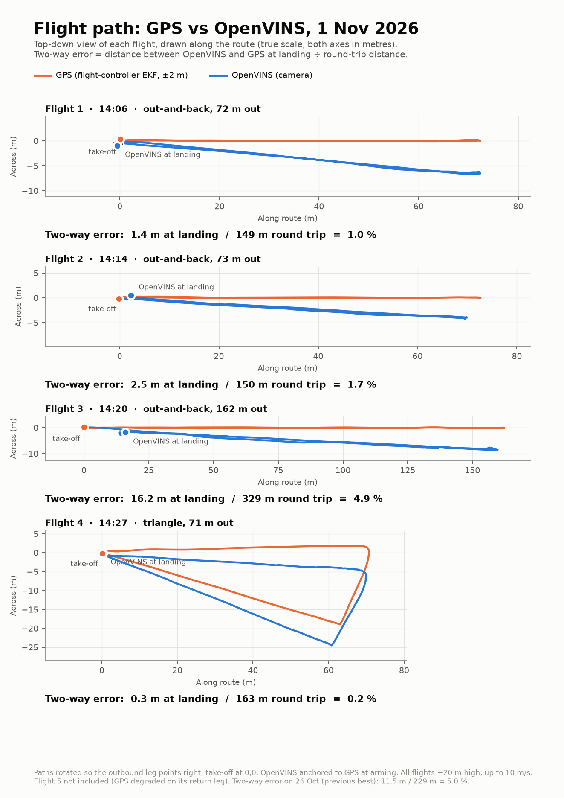
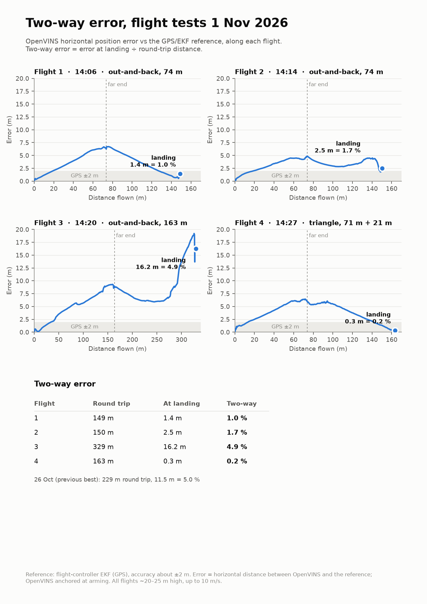
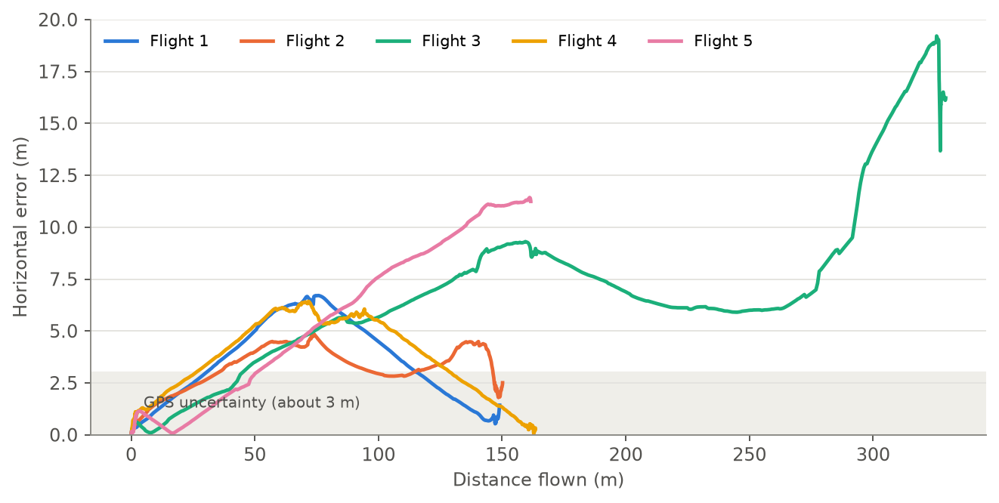
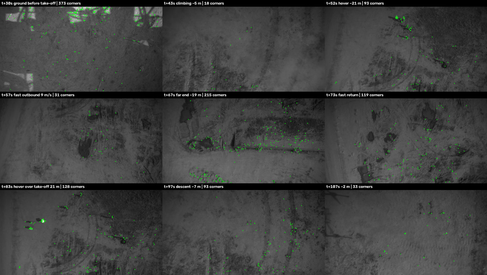
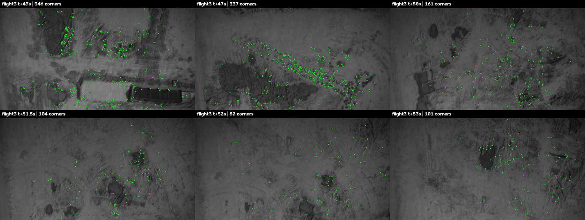
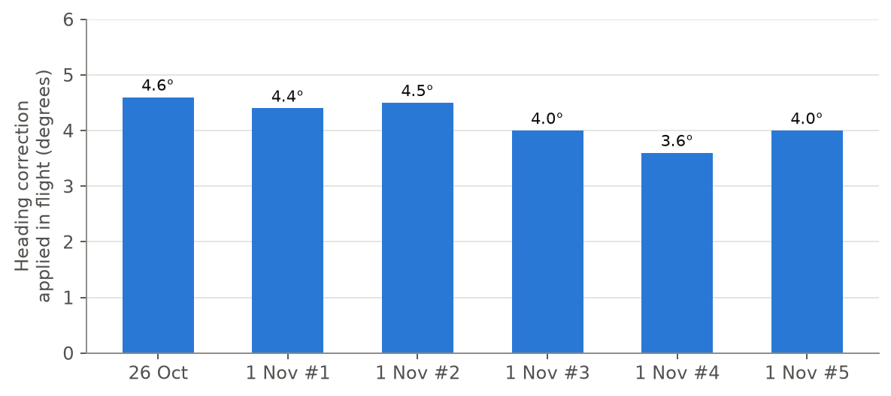
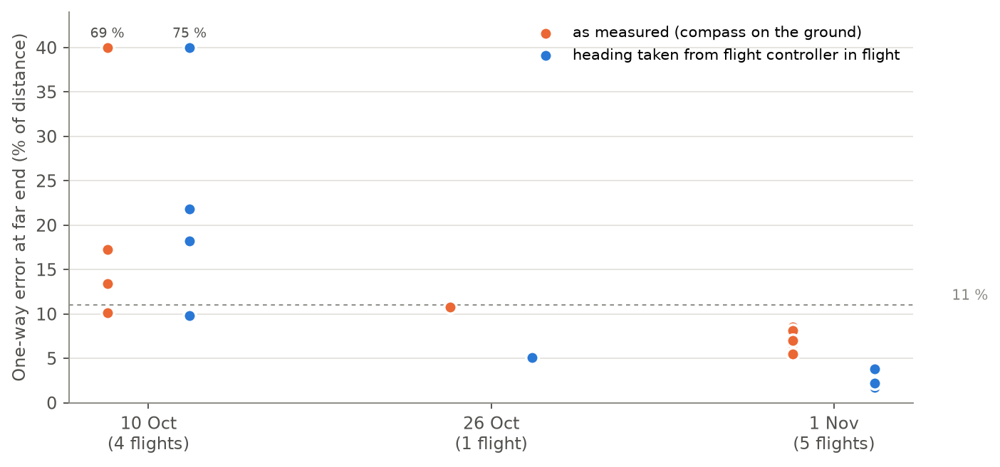

# Flight analysis: 1 Nov 2026 (third flight test day)

Five automatic GPS missions with OpenVINS recorded live on the Jetson, each compared with the
flight-controller log using [`scripts/analysis/`](../../../scripts/analysis/). Same estimator and
`config/` as 10 Oct and 26 Oct (md5 fingerprints in each `session.txt`).

**Headline:** two-way error **0.2 % to 1.7 %** on 3 of 4 flights (4.9 % on one), one-way error at the
far end **5.5 % to 8.5 %**. Most of the one-way error is a **~4° compass heading error on the ground**,
not OpenVINS (section 5). With heading supplied by the flight controller at every moment (what a
connected compass is meant to provide) the one-way error is **1.7 % to 3.8 %**; with a realistic
2.5° compass error it is **4.8 % to 6.5 %** (simulated, worst-case direction).

All numbers are **horizontal** (a lidar height reference is planned). Bags and `.bin` logs are not in
the repo (size, and the logs contain the site's GPS coordinates).

---

## 1. Sessions and logs

| Bag (vajra `~/flights/2026-11-01/`) | Flight-controller log | Flight | Notes |
|---|---|---|---|
| `flight01_140500` | `14-06-03.bin` | 1: out and back, 74 m | FC log is a separate file (FC was restarted at ~14:11) |
| `flight02_141329` | `14-14-32.bin` (A) | 2: out and back, 74 m | one `.bin` holds flights 2 to 5; split by arming times |
| `flight03_141922` | `14-14-32.bin` (B) | 3: out and back, 163 m | tracking failure on the return (section 4) |
| `flight04_142501` | `14-14-32.bin` (C) | 4: triangle, 71 m + 21 m, 150° yaw at 80°/s | best two-way result |
| `flight05_143427` | `14-14-32.bin` (D) | 5: out and back, 162 m, 25 m high | GPS degraded on the return: **analysed only up to the far-end waypoint**; Jetson lost power seconds after the recording stopped (bag intact) |

All flights about **20 m high** (25 m on flight 5), **up to 10 m/s**. Every recording is clean:
images 30 Hz, camera IMU ~493 Hz, OpenVINS 15 Hz with no gap over 0.18 s, one initialisation and one
clean exit each, OpenVINS ran every flight start to finish. Time sync correlation 0.88 to 1.00.
A `12-35-20.bin` log is a ground motor test, not a flight.

GPS reference (receiver accuracy HAcc in flight): flights 1 to 4: 1.5 to 2.8 m, 14 to 16 satellites,
EKF test ratios ≤ 0.3. Flight 5: good to the far end, then HAcc 4 to 6.7 m, "GPS Glitch or Compass
error" and GPS velocity rejected by the EKF on the return. Flight 1's log has a GPS glitch 5 s **after
landing**; the comparison stops at touchdown. A 1.5 to 2 m gap between raw GPS and the EKF on fast
legs is ordinary GPS delay at 10 m/s, not a glitch.

## 2. Results

| Flight | Two-way (landing error / round trip) | One-way at far end, as measured | One-way, heading from FC in flight | One-way, + 2.5° compass error (worst case) |
|---|---|---|---|---|
| 1 | 1.4 m / 149 m = **1.0 %** | 6.3 m / 74 m = 8.5 % | 1.3 m = **1.8 %** | 4.5 m = 6.1 % |
| 2 | 2.5 m / 150 m = **1.7 %** | 4.9 m / 74 m = 6.6 % | 2.8 m = **3.8 %** | 4.7 m = 6.4 % |
| 3 | 16.2 m / 329 m = **4.9 %** | 9.0 m / 163 m = 5.5 % | 2.8 m = **1.7 %** | 7.8 m = 4.8 % |
| 4 (triangle) | 0.3 m / 163 m = **0.2 %** | 6.0 m / 74 m = 8.1 % | 1.7 m = **2.4 %** | 4.8 m = 6.5 % |
| 5 (outbound only) | not measurable | 11.2 m / 162 m = 7.0 % | 3.6 m = **2.2 %** | 10.3 m = 6.4 % |
| 26 Oct #5 (same method) | 11.5 m / 229 m = 5.0 % | 12.4 m / 114 m = 10.8 % | 5.8 m = 5.1 % | |

**Against the GPS tolerance:** the receiver reported 1.5 to 3.0 m in flight, so **±3 m** is used as the
tolerance. With heading removed, flights 1, 2, 3 and 4 stay within that up to their far end; flight 5
is 0.6 m above it. These flights cannot resolve errors below about 2 to 3 %. Longer one-way legs
(300 m or more) or RTK GPS are needed for that.

Other measures: scale 0.96 to 1.03; height error under 2.2 m; best-fit (4-DoF) error 0.9 to 2.0 m on
flights 1, 2, 4, 5; error inside OpenVINS's own 3σ only 6 % to 37 % of the time (still over-confident);
camera vibration 5 to 9 m/s². Per-flight output: `tN_metrics.txt`, `tN_report.png`.

## 3. Ground texture

FAST corners per image in the air (threshold 20, as OpenVINS uses): median 88 to 263, much less than
26 Oct (388), because of bare sandy soil and the greater height (one pixel ≈ 5 cm of ground at 20 m).
Overall texture did **not** predict accuracy (flights 1 and 4 had the least texture and were among the
best); it mattered only when a very sparse patch met full speed (section 4).

## 4. Flight 3: tracking failure on the return

At t+50 to 53 s after take-off, about 290 m into the flight, at 9 to 10 m/s over bare sandy ground near
home, corners dropped to 12 to 77 per image and OpenVINS under-read its own speed by 20 to 35 % for
about 4 s, adding about 10 m of error that stayed until landing.

Flights 1 and 2 flew **the same return track within 0.5 m** at the same speed over equally poor
ground without failing. Ruled out: distance (no growth before the event), zero-velocity updates
(ZUPT fired only after the jump, while hovering), processing delay or rejected updates (nothing in the
log), accelerometer bias (similar on all flights). Open; next test is a replay with more features
(FAST threshold 5 to 10, 300 features, `track_frequency` 31).

## 5. The heading error is mostly the compass, not OpenVINS

OpenVINS's track has the right shape but is turned +3 to +6°, always the same way, on all five flights
and on 26 Oct. The flight controller's heading turned **3.3 to 4.5° more than its own gyro** between
arming and the far end on every flight (26 Oct: 4.6 to 5.3°): its compass was about 4° off on the
ground and GPS corrected it quietly once the drone moved. The analysis takes its starting heading from
that ground compass, so the compass error appeared as OpenVINS error. A heading error rotates the whole
track about take-off, so it cancels on any route that returns home (two-way error hides it).

Tools: [`compass_offset_check.py`](../../../scripts/analysis/compass_offset_check.py) (EKF heading
minus integrated gyro between two log times; end the window before fast yaw turns, the 25 Hz log
cannot integrate them) and [`compass_simulation.py`](../../../scripts/analysis/compass_simulation.py)
(rebuilds each OpenVINS track with the flight controller's heading applied to every step; add a fixed
compass error by rotating the result about take-off).

## 6. Field findings

- **RTL ignores mission ChangeSpeed:** the return was flown at ~10 m/s although 1.5 to 2 m/s was set.
  Set `RTL_SPEED` or end missions with a waypoint and LAND.
- **Battery current sensor reads 0 A:** no mAh logging, and CompassMot (motor interference
  compensation) cannot work until it is fixed.
- **Jetson power loss** right after flight 5 (third since 26 Oct). The clock restored to the last saved
  time (~30 min behind); sync from the PC before the next session.
- Logging is armed-only (`LOG_DISARMED = 0`), so one `.bin` can hold several flights.

## 7. Operating envelope (all three test days)

Seven of ten flights stayed at or below 11 % one-way with heading from the flight controller; every
failure broke at least one of the first four limits:

1. height ≥ 9 m (best 14 to 25 m);
2. speed ÷ height ≤ ~0.5 s⁻¹ (10 m/s at 20 m); the old 0.35 rule was too strict;
3. textured ground: median ≥ ~90 corners per image, no long stretches under ~50 at full speed;
4. straight legs, no long hovers or zig-zags; fast yaw turns are fine (150° at 80°/s tested);
5. tested only up to ~160 m one-way and ~100 s in the air;
6. compass within ~4° (each degree adds ~1.7 % one-way).

## 8. Conclusions

1. Best day so far: two-way 0.2 to 1.7 % (3 of 4), one-way 5.5 to 8.5 % as measured.
2. The dominant remaining error is the ground compass heading (~4°). Fix the compass (current sensor,
   CompassMot, field calibration, mast mount; RM3100 magnetometer) and fly a short GPS leg first.
3. OpenVINS itself contributes about 1 to 4 m over 70 to 160 m once heading is handled (at the limit
   of the GPS reference).
4. One flight in five had a short tracking failure over bare ground at speed. That, not slow drift,
   is the open problem.
5. Videos of the worst flight (10 Oct #1) and best flight (this day, #4) are in
   [`docs/videos/`](../../videos/). The full handover manual is
   [`docs/VPS_Navigation_System_Manual.docx`](../../VPS_Navigation_System_Manual.docx).
